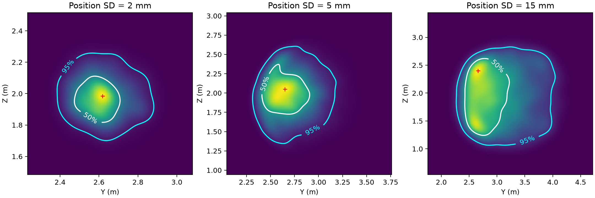

# UPC 2026 · Problem B — 团队共享仓库（UPC155）

> **赛事：** University Physics Competition 2026 · **题目：** Problem B（点球早期轨迹 → 球门平面穿越位置概率预测）
> **仓库用途：** 全队共享仓库。B 组（仿真/概率模型方向）把可共享的代码、报告与结果放在这里，供 A（物理/数据）、C（评价/图表/论文）直接取用；A/C 的调研资料与论文模板也在此。
> **整理时间：** 2026-11-07 17:10 左右 · **状态：开发中，结果均为仿真结果，未经真实轨迹校准，不代表最终论文结论。**

本仓库内容来自 B 同学与 ChatGPT（Codex 模式）在 2026-11-07 13:34–16:29 的工作会话：**代码、实验与报告主要由 ChatGPT 生成，B 同学负责审查与验收**。完整对话记录保存在 B 同学本机，按比赛官方要求整理后进入论文的 AI 使用披露附录（本公开仓库不包含原始对话）。仓库中的调研资料与论文模板由队友上传，见 §2。

---

## 1. 题目与建模目标（简述）

- 罚球点为原点，球门位于 **x = 11 m** 平面，横向 **y ∈ (−3.66, 3.66) m**，竖直 **z ∈ (0, 2.44) m**。
- 已知：球心初始位置 **r(0) = (0, 0, 0.11) m**，以及 **r(0.05 s)**、**r(0.10 s)** 两个早期位置。
- 任务：预测球**第一次向前穿越 x = 11 m** 的坐标 **(Y, Z)**，给出**最可能穿越点**、**联合 50% / 95% 预测区域**，以及落入门框内的概率。
- 关键限制：初速度、旋转、气动参数都**未知**，只能由两个早期位置反演；最终穿越点只能作标签/验证，不能作为输入。

**题目案例输入：** `r(0)=(0,0,0.11)`，`r(0.05)=(1.50,0.45,0.44)`，`r(0.10)=(2.96,0.86,0.74)`（单位 m）。
恒加速度解析基线：**T ≈ 0.405 s，(Y, Z) ≈ (2.495, 1.920) m**（最早文稿写作 1.921，按三位小数应为 1.920）。

## 2. 目录结构

```
UPC155/
│
├── 【B 组产出：代码 / 报告 / 结果】（GPT 2026-11-07 会话，完整清单见 inventory.md）
│   ├── UPC-B题-中文研究路线.md            # 研究路线（主线方案，含可辨识性、误差分析、验证设计）
│   ├── UPC-B题-高分作品因素与路线修订.md   # 往届高分作品经验 + 对路线的修订依据
│   ├── UPC-B题-团队实验方案.md            # 给全队看的实验方案（分工、阶段交付、验收指标）
│   ├── UPC-B题-数据获取渠道与联系邮件.md   # 真实数据渠道（ISSIA-3D / ball3d / IDSSE）+ 英文邮件草稿
│   ├── data_sources/
│   │   └── ISSIA-3D.csv                 # 已下载的公开三维球位置数据（来源与许可见 §7）
│   └── student_b/                       # B 组工作区（代码 + 报告 + 结果）
│       ├── README.md                    # 代码说明、物理/统计约定、本机运行方式（先看这个）
│       ├── physics.py                   # 批量 RK4 三维物理引擎：重力 + 二次阻力 + 横向旋转马格努斯力 + 穿越/触地事件
│       ├── test_physics.py              # 解析退化、耗散、正交性、触地、步长收敛 6 项检查
│       ├── inference.py                 # 物理约束贝叶斯重要性采样（显式 p/q 校正、ESS 诊断）
│       ├── test_inference.py            # 已知截断高斯后验的采样正确性检查
│       ├── experiment.py                # 生成数据 → 训练全协方差 MDN → 覆盖率/面积评测 → 案例输出（CLI）
│       ├── validate.py                  # 全新仿真样本上的模型对照（benchmark / case），输出联合预测区域
│       ├── screen_issia.py              # ISSIA-3D 连续空中片段筛选
│       ├── run_overnight.py             # 分阶段批处理脚本（阶段级落盘、可续跑）
│       ├── requirements.txt             # numpy / scipy / torch / matplotlib
│       ├── environment-freeze.txt       # 本机实际环境版本（Python 3.13 + CPU 版 PyTorch）
│       ├── 开发结果与待办.md             # 第一轮结果（旧参数）+ 待办
│       ├── 气动参数更新结果.md           # 接入 A 的气动参数后的重训结果（新参数）
│       ├── ISSIA筛选与仿真验证.md        # ISSIA 筛选 + 全新仿真样本对照 + 案例联合区域
│       ├── 审查清单.md                   # 请 A/B 同学优先审查的代码与假设清单
│       └── runs/                        # 结果（JSON/PNG/日志/模型权重；大数组未上传，见 inventory.md）
│
├── 【队友上传的前期调研与论文资料】（x1shang @ 2026-11-07 16:39）
│   ├── UPC赛事调研报告.md               # UPC 赛事调研主报告：规则、奖项比例、历年题、高分经验
│   ├── AB-资料总览.md                   # A/B 两题资料与文献索引（B 题关键结论 + 推荐阅读顺序）
│   ├── 未命名.md                        # C_D / C_L 物理含义速查（气动系数、阻力危机、马格努斯力）
│   ├── raw/                             # 调研原始材料：官方规则/历年页、中文获奖访谈与战报、检索快照
│   ├── 准备文档.xlsx                    # 组内准备表（时间线/分工/核对清单）
│   └── 论文模板/                        # C 的 LaTeX 论文骨架：main.tex、ai-report.tex、使用说明、main.pdf
│
├── README.md                        # 本文件：总览、进度、给队友的接口
├── inventory.md                     # B 组全部成果清单（含未上传大文件与复现方法）
└── .gitignore                       # 忽略 __pycache__ 与大体积 .npz/.npy 中间数据
```

> `UPC-B题-团队实验方案.md` 由 B 组产出，队友在同一次上传中同步了同一文件（内容一致、blob 相同）。调研材料由队友 `x1shang` 于 2026-11-07 16:39 上传，B 组未改动其内容。

## 3. 当前进度与关键结果（截至 2026-11-07 16:30）

### 已完成

- **物理引擎**：NumPy 批量 RK4（δt = 0.001 s），无风主模型 + 可配置横风/升力倍率/旋转衰减；升力用**横向旋转** `CL = min(1.4·S, 0.30)`，`S = R·|ω×u|/|u|²`，**零旋转与轴向旋转升力为零**；球门穿越线性插值求交，触地按球心 z ≤ R 截断。
- **贝叶斯物理推断**：四轮自适应重要性采样，显式 `p/q` 权重、20% 先验混合、ESS / 最大权重 / 跨种子稳定性诊断；不把采样次数当有效样本量。
- **全协方差 MDN**：输入 6 个早期坐标 + 噪声水平 σ（7 维），输出 K 个含相关系数 ρ 的二维高斯分量；轨迹级数据划分（同轨迹不同噪声不跨集）；早停；覆盖率 / HDR 面积 / 中位误差评测。
- **气动参数已接入 A 提供的取值**：m = 0.430 kg，R = 0.110 m，ρ = 1.20 kg/m³，C_D 基准 0.22（敏感性 0.15–0.30 均匀），`CL = min(1.4S, 0.30)`。
- **自动测试**：7 项全部通过（在本仓库 `student_b` 目录下实测 OK，0.4 s）。

### 关键数值（均为**文献参数约束下的仿真结果**，不是实测性能）

**新参数 MDN 重训（`runs/literature50k/`，4,187 条有效空中穿越留出样本，点预测用分布均值）：**

| 位置误差 σ | 旧 MDN 中位误差 | 新 MDN 中位误差 | 新 MDN 50% 覆盖 | 新 MDN 95% 覆盖 |
|---|---:|---:|---:|---:|
| 2 mm | 0.232 m | **0.163 m** | 58.6% | 97.6% |
| 5 mm | 0.403 m | **0.322 m** | 52.3% | 96.3% |
| 15 mm | 0.656 m | **0.556 m** | 46.5% | 96.8% |

**题面案例（σ = 5 mm 情景，物理贝叶斯后验，`runs/fresh_validation/`）：**

- 最可能穿越点（加权 KDE 网格众数）：**(Y, Z) ≈ (2.650, 2.052) m**
- 50% / 95% 联合区域面积：**0.219 / 0.809 m²**
- 注：2 mm 情景 ESS 仅约 124，数值应谨慎解读；15 mm 情景 95% 区域面积 2.645 m²。



**全新仿真样本上的预测器对照（`runs/fresh_validation/benchmark.json`，各 σ = 5 mm，只统计达到 ESS ≥ 100 门槛的可配对样本）：**

| 场景 | 可配对/总样本 | 恒加速度 | MDN | 物理推断 | MDN / 物理能量评分 |
|---|---:|---:|---:|---:|---:|
| 无风 | 9 / 12 | 0.425 m | 0.341 m | 0.353 m | 0.258 / 0.211 m |
| 3 m/s 横风 | 10 / 12 | 0.804 m | 0.352 m | 0.266 m | 0.233 / 0.169 m |

**ISSIA-3D 数据筛选（`runs/issia_screen/`）：** 2,465 行中 1,689 行有可用三维坐标；重投影误差 ≤ 10 px 时筛出 25 个连续空中片段，其中 5 段首尾水平位移 > 11 m。但该 CSV **缺少离脚时刻与点球事件标签**，25 fps 也不对应 0.05/0.10 s 采样，**目前未进入训练/校准/验证**。

### 已知局限（论文中不得写成"已完成"）

- 全部结果为**仿真分布内**结果；真实轨迹校准与独立实测验证**未完成**（A 尚未提供真实数据，ISSIA 暂不可用）。
- MDN 的 **50% 区域校准仍不足**（实际覆盖 46–59%）；95% 区域接近标称但受样本量与 ESS 影响。
- 模型对照样本量小（每场景 12 条），5 条因低 ESS 未纳入配对统计，不能解读为全样本排名。
- 变阻力曲线（速度依赖 C_D）、旋转衰减、物理特征增强消融、大样本多种子稳定性均**未系统完成**。

## 4. 给队友的接口

### 给 A（物理 / 数据 / 文献）

1. **真实轨迹（最优先）**：需要"时间戳 + 三维球心坐标 + 单位 + 坐标系说明 + 离脚时刻/帧率 + 测量误差说明"。只需**已公开或赛前已有**的数据，比赛期间不得请队外人员采集/处理。
2. **ISSIA 核查**：若有原视频，请核查候选片段帧 **608–627、1056–1084、1144–1172、2972–2998**（另一段 2892–2937 拟合残差大），记录球是否中途碰人/触地/被遮挡。
3. **参数表复核**：确认 `student_b/physics.py` 中升力公式、先验范围与文献出处（见 `气动参数更新结果.md`、`审查清单.md`）。
4. **可直接用的调研资料**：`AB-资料总览.md` 的 B 题文献清单与推荐阅读顺序（SpringerPlus 的 Cd(Re)/阻力危机；2025 arXiv 的少量观测拟合轨迹；JCGM GUM 的不确定度写法）；`UPC赛事调研报告.md` + `raw/chinese/` 里的获奖访谈经验。

### 给 C（评价 / 图表 / 论文）

可直接取用：

- 案例联合区域图：`student_b/runs/fresh_validation/case_regions.png`；原始数值 `runs/fresh_validation/case_regions.json`
- 新旧模型对照表：`runs/literature50k/`（原始数据 `paired_comparison.json`、`evaluation.json`）
- 全新仿真对照表：`student_b/runs/fresh_validation/benchmark.json`
- 方法/公式/约定：`student_b/README.md` + `UPC-B题-中文研究路线.md`
- **论文骨架已就位**：`论文模板/main.tex`（IMRAD、Summary ≤300 词、匿名要求）+ `论文模板/ai-report.tex`（AI 使用披露记录骨架，按官方规则填写）；编译与提交核对见 `论文模板/使用说明.md`
- 高分写作经验：`raw/chinese/` 中 SJTU/南航/上科大/同济等获奖访谈与战报；`UPC赛事调研报告.md` 有汇总

引用时必须标注："**文献参数约束下的仿真结果，样本量有限，尚未经真实轨迹校准**"，并区分"仿真一致性"与"现实准确性"。

### 给队友的同步消息（可直接粘贴到群里）

> B 组已完成 5 万条文献参数仿真数据的生成、MDN 训练和第一轮模型对照，代码与结果已上传共享仓库：
> https://github.com/blind-shrimp/UPC155
>
> - **A 同学**：如果已经拿到真实轨迹，请发文件或链接，以及帧率、坐标单位、离脚时刻和误差说明；如果没有，回一句"暂无新数据"即可。若手边有 ISSIA 原视频，麻烦核查帧 608–627、1056–1084、1144–1172、2972–2998 中球是否中途碰人、触地或被遮挡。
> - **C 同学**：题面案例（σ = 5 mm）可先用：最可能穿越点 **(2.650, 2.052) m**，50% / 95% 联合区域面积 **0.219 / 0.809 m²**（图 `student_b/runs/fresh_validation/case_regions.png`）；方法对照请标为"小样本仿真验证"，注明 24 条中 5 条因有效样本量不足未纳入配对统计。
>
> **当前限制**：尚无真实数据校准；50% 区域覆盖率偏低（46–59%）；结论只能写成条件性仿真预测。

## 5. 快速开始（复现）

本机（B 同学）使用 conda 环境 `C:/Users/pc/miniconda3/envs/mujoco/python.exe`（Python 3.13，numpy 2.5.4 / scipy 1.18.1 / torch 2.14.1+cpu）。新环境安装：

```powershell
python -m pip install -r student_b/requirements.txt
```

在**仓库根目录**运行：

```powershell
# 1) 7 项自动测试
python -m unittest discover -s student_b -v

# 2) 端到端小规模冒烟（生成 → 训练 → 评测）
python student_b/experiment.py smoke --out student_b/runs/literature_dev --n 10000 --epochs 60

# 3) 5 万条完整重跑：分阶段顺序执行 generate→train→evaluate→case（CPU 约 80 s）
python student_b/run_overnight.py --out student_b/runs/overnight --n 50000 --epochs 150
#    单阶段也可单独跑（命令可为 generate / train / evaluate / case）：
#    python student_b/experiment.py train --out student_b/runs/newrun --epochs 150

# 4) 题面案例：固定 Cd = 0.22 的贝叶斯推断
python student_b/experiment.py case --out student_b/runs/case_cd022 --n 30000 --cd 0.22

# 5) 全新仿真样本对照 + 案例联合预测区域
python student_b/validate.py benchmark --output student_b/runs/fresh_validation --n 6000
python student_b/validate.py case --output student_b/runs/fresh_validation --n 40000

# 6) ISSIA-3D 连续空中片段筛选
python student_b/screen_issia.py data_sources/ISSIA-3D.csv student_b/runs/issia_screen
```

> 命令与参数以 `student_b/README.md` 为准（该文件由 GPT 原始产出，逐字保留）。`student_b/runs/` 中已有结果可直接查看，无需重跑。

## 6. 路径与来源约定

- 仓库内文档保留了 GPT 原始产出中的本机绝对路径（如 `C:/Users/pc/Documents/ChatGPT/upc/...`），那是 B 同学本机的原始路径，**在仓库中请按上文目录结构对应查找**，无需尝试访问。
- 本仓库由 B 同学从 ChatGPT 工作区 `F:\ChatGPT\upc`（即 `C:\Users\pc\Documents\ChatGPT\upc` 的映射）整理导出；文件内容为逐字复制，仅补充本 README / inventory / .gitignore。
- 原始工作区自带的 `student_b/.gitignore`（忽略整个 `runs/`）未复制，仓库改用根目录 `.gitignore`：只忽略 `__pycache__`、`*.pyc`、`*.npz`、`*.npy`。

## 7. 数据与合规

- **ISSIA-3D.csv**：来自 SoccerNet-v3D 官方仓库发布的 ISSIA-3D 标注（`mguti97/SoccerNet-v3D` release v1.0.0），用于研究用途，引用其论文并遵守发布条款；本仓库仅转载该标注文件。原始采集说明：<https://pspagnolo.jimdofree.com/download/>
- 2022 年 UPC 获奖论文等第三方材料**未上传**（仅作学习参考，版权归原作者）。
- **比赛规则**：比赛期间不得请队外人员采集/处理数据或参与分析；AI 使用需在论文中披露系统、原始提问与完整输出。本仓库只包含 B 组自己的工作产物。
- 数据获取申请（ball3d / ISSIA 作者）目前**尚未发信**，草稿见 `UPC-B题-数据获取渠道与联系邮件.md`。

## 8. 下一步（B 组）

1. 接入 A 确认的最终先验/升力公式与真实轨迹（或 ISSIA 可用片段），重生成数据并重训。
2. 解决 50% 区域校准（温度缩放 / 噪声条件化再训练 / 更大样本）。
3. 在**同一测试子集**上扩大无风与横风对照样本量（当前 12 条/场景），补分布偏移与物理特征消融。
4. 为 C 输出可直接进论文的三线表（LaTeX）与 300 dpi 图；论文中所有数字与本仓库结果文件一一对应。

## 9. 协作约定（给全队）

- **目录归属**：B 组新产出放 `student_b/`；调研/文献摘要放 `raw/`；论文放 `论文模板/`；不要互相覆盖他人目录。
- **大文件不入库**：文献 PDF、仿真大数组（`.npz/.npy`）、视频不要直接提交（体积与版权原因），用 `raw/*.md` 摘要 + DOI 引用；`.npz/.npy` 已在 `.gitignore` 中。
- **数字可追溯**：论文/汇报中出现的每个数字都应能对上 `student_b/runs/` 里的 JSON 或报告中的表格；不确定的写成"待验证"。
- **公开仓库注意**：本仓库是公开的，不要放入个人信息、未公开数据、问卷/联系方式等；AI 使用记录按官方规则在论文附录披露。
- **提交信息**：写清"谁 + 哪个方向 + 改了什么"，例如 `feat(A): 新增真实轨迹校准脚本`。

