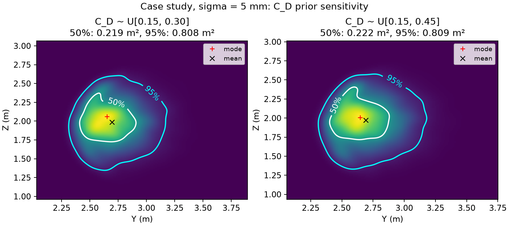

# UPC 2026 · Problem B — 团队共享仓库（UPC155）

> **最新整合**：A 新增数据去重后为六个案例，C 已有论文初稿，B 覆盖审计已并入。当前状态请先看 [agent_readme.md](agent_readme.md) 和 [新增数据整合](student_b/新增数据整合.md)，下文保留早期实验记录。

> **赛事：** University Physics Competition 2026 · **题目：** Problem B（点球早期轨迹 → 球门平面穿越位置概率预测）
> **仓库用途：** 全队共享仓库。B 组（仿真/概率模型方向）把可共享的代码、报告与结果放在这里，供 A（物理/数据）、C（评价/图表/论文）直接取用；A/C 的调研资料与论文模板也在此。
> **整理时间：** 2026-11-07 18:20 左右（已并入 Codex 16:50–16:52 产出、A→B 交接包 v2、微信 14 条消息留档；A 已确认 §3 修正、面积写法与 ISSIA 定位） · **状态：开发中，结果均为仿真结果，未经真实轨迹校准，不代表最终论文结论。**

本仓库内容来自 B 同学与 ChatGPT（Codex 模式）在 2026-11-07 13:34–16:29 的工作会话：**代码、实验与报告主要由 ChatGPT 生成，B 同学负责审查与验收**。完整对话记录保存在 B 同学本机，按比赛官方要求整理后进入论文的 AI 使用披露附录（本公开仓库不包含原始对话）。仓库中的调研资料与论文模板由队友上传，见 §2。

---

## 1. 题目与建模目标（简述）

- 罚球点为原点，球门位于 **x = 11 m** 平面，横向 **y ∈ (−3.66, 3.66) m**，竖直 **z ∈ (0, 2.44) m**。
- 已知：球心初始位置 **r(0) = (0, 0, 0.11) m**，以及 **r(0.05 s)**、**r(0.10 s)** 两个早期位置。
- 任务：预测球**第一次向前穿越 x = 11 m** 的坐标 **(Y, Z)**，给出**最可能穿越点**、**联合 50% / 95% 预测区域**，以及落入门框内的概率。
- 关键限制：初速度、旋转、气动参数都**未知**，只能由两个早期位置反演；最终穿越点只能作标签/验证，不能作为输入。

**题目案例输入：** `r(0)=(0,0,0.11)`，`r(0.05)=(1.50,0.45,0.44)`，`r(0.10)=(2.96,0.86,0.74)`（单位 m）。
恒加速度解析基线：**T ≈ 0.405 s，(Y, Z) ≈ (2.495, 1.920) m**（最早文稿写作 1.921，按三位小数应为 1.920）。

## 2. 目录结构

```
UPC155/
│
├── 【B 组产出：代码 / 报告 / 结果】（GPT 2026-11-07 会话，完整清单见 inventory.md）
│   ├── UPC-B题-中文研究路线.md            # 研究路线（主线方案，含可辨识性、误差分析、验证设计）
│   ├── UPC-B题-高分作品因素与路线修订.md   # 往届高分作品经验 + 对路线的修订依据
│   ├── UPC-B题-团队实验方案.md            # 给全队看的实验方案（分工、阶段交付、验收指标）
│   ├── UPC-B题-数据获取渠道与联系邮件.md   # 真实数据渠道（ISSIA-3D / ball3d / IDSSE）+ 英文邮件草稿
│   ├── data_sources/
│   │   └── ISSIA-3D.csv                 # 已下载的公开三维球位置数据（来源与许可见 §7）
│   └── student_b/                       # B 组工作区（代码 + 报告 + 结果）
│       ├── README.md                    # 代码说明、物理/统计约定、本机运行方式（先看这个）
│       ├── physics.py                   # 批量 RK4 三维物理引擎：重力 + 二次阻力 + 横向旋转马格努斯力 + 穿越/触地事件
│       ├── test_physics.py              # 解析退化、耗散、正交性、触地、步长收敛 6 项检查
│       ├── inference.py                 # 物理约束贝叶斯重要性采样（显式 p/q 校正、ESS 诊断）
│       ├── test_inference.py            # 已知截断高斯后验的采样正确性检查
│       ├── experiment.py                # 生成数据 → 训练全协方差 MDN → 覆盖率/面积评测 → 案例输出（CLI）
│       ├── validate.py                  # 全新仿真样本上的模型对照（benchmark / case），输出联合预测区域
│       ├── screen_issia.py              # ISSIA-3D 连续空中片段筛选
│       ├── run_overnight.py             # 分阶段批处理脚本（阶段级落盘、可续跑）
│       ├── requirements.txt             # numpy / scipy / torch / matplotlib
│       ├── environment-freeze.txt       # 本机实际环境版本（Python 3.13 + CPU 版 PyTorch）
│       ├── params.json                  # ★ 唯一有效参数表（A→B 口径定稿 v2）
│       ├── selftest_case.json           # A 的自检用例（机器可读，测试直接 assert）
│       ├── check_issia_arcs.py          # ISSIA 两段：零旋转 6 帧前缀外推（Codex 16:51）
│       ├── case_cd_prior.py             # 案例：C_D 先验上限敏感性（50%/95% 区域面积对比）
│       ├── fit_issia_cd_lift.py         # ISSIA：加竖直净升力后的 (C_D, L) 可辨识性检验
│       ├── test_selftest_case.py        # A 自检用例的 7 项单元测试（当前 14 项全过）
│       ├── 开发结果与待办.md             # 第一轮结果（旧参数）+ 待办
│       ├── 气动参数更新结果.md           # 接入 A 的气动参数后的重训结果（新参数）
│       ├── ISSIA筛选与仿真验证.md        # ISSIA 筛选 + 全新仿真样本对照 + 案例联合区域
│       ├── 给A的回签与ISSIA外推结果.md    # B→A 回签（Codex 16:52）+ 两段外推表
│       ├── 给A的回复_第三轮.md           # ★ 对 A 交接包 v2 的回复（面积对比/方向勘误/拟合结果）
│       ├── 对A自检用例的核对.md           # ★ 自检用例 §3 升力方向约定的勘误与证据
│       ├── ISSIA_CD_L拟合检验.md         # ★ 竖直净升力 (C_D, L) 检验报告
│       ├── 审查清单.md                   # 请 A/B 同学优先审查的代码与假设清单
│       └── runs/                        # 结果（含 runs/issia_A/、runs/case_cd_prior/；大数组未上传）
│
├── 【A→B 交接包 v2】（2026-11-07，A 交付；SHA256 已核对）
│   └── A到B_v2_2026-11-07/              # 口径定稿 v2、ISSIA 数据说明、自检用例、回签单、两段轨迹与校验和
│
├── 【微信收到：溪上 14 条消息】（2026-11-07 18:02，原样留档）
│   └── wechat_archive/2026-11-07_溪上/   # 00_对话记录.md；messages/ images/ code/ parameters/ reports/ plans/ packages/ extracted/
│
├── 【队友上传的前期调研与论文资料】（x1shang @ 2026-11-07 16:39）
│   ├── UPC赛事调研报告.md               # UPC 赛事调研主报告：规则、奖项比例、历年题、高分经验
│   ├── AB-资料总览.md                   # A/B 两题资料与文献索引（B 题关键结论 + 推荐阅读顺序）
│   ├── 未命名.md                        # C_D / C_L 物理含义速查（气动系数、阻力危机、马格努斯力）
│   ├── raw/                             # 调研原始材料：官方规则/历年页、中文获奖访谈与战报、检索快照
│   ├── 准备文档.xlsx                    # 组内准备表（时间线/分工/核对清单）
│   └── 论文模板/                        # C 的 LaTeX 论文骨架：main.tex、ai-report.tex、使用说明、main.pdf
│
├── README.md                        # 本文件：总览、进度、给队友的接口
├── inventory.md                     # B 组全部成果清单（含未上传大文件与复现方法）
└── .gitignore                       # 忽略 __pycache__ 与大体积 .npz/.npy 中间数据
```

> `UPC-B题-团队实验方案.md` 由 B 组产出，队友在同一次上传中同步了同一文件（内容一致、blob 相同）。调研材料由队友 `x1shang` 于 2026-11-07 16:39 上传，B 组未改动其内容。

## 3. 当前进度与关键结果（截至 2026-11-07 18:20；A 已确认 §3 修正、面积写法与 ISSIA 定位）

### 已完成

- **物理引擎**：NumPy 批量 RK4（δt = 0.001 s），无风主模型 + 可配置横风/升力倍率/旋转衰减；升力用**横向旋转** `CL = min(1.4·S, 0.30)`，`S = R·|ω×u|/|u|²`，**零旋转与轴向旋转升力为零**；球门穿越线性插值求交，触地按球心 z ≤ R 截断。新增 `fixed_cl`（仅用于 A 自检用例的常系数验证，不参与任何实验）。
- **贝叶斯物理推断**：四轮自适应重要性采样，显式 `p/q` 权重、20% 先验混合、ESS / 最大权重 / 跨种子稳定性诊断；不把采样次数当有效样本量。已支持 `cd_upper` 先验上限参数（Codex 16:51）。
- **全协方差 MDN**：输入 6 个早期坐标 + 噪声水平 σ（7 维），输出 K 个含相关系数 ρ 的二维高斯分量；轨迹级数据划分（同轨迹不同噪声不跨集）；早停；覆盖率 / HDR 面积 / 中位误差评测。
- **气动参数**：已按 **A→B 口径定稿 v2** 接入（`student_b/params.json` 为唯一参数表）。
- **自动测试**：**14 项全部通过** = 原有 7 项 + A 自检用例 7 项（`test_selftest_case.py`，含零叉积→升力为 0 的断言）。
- **A 的 v2 交接包**已入库（`handoff/A到B_v2_2026-11-07/`），SHA256 逐一核对一致。
- **微信 14 条消息已留档**（2026-11-07 18:02，溪上 → B）：3 条文字 + 1 条链接 + 1 张图片 + 9 个文件，按类型存入 `wechat_archive/2026-11-07_溪上/`，逐条清单与 SHA256 见该目录 `00_对话记录.md`。其中 07/09/10/11/13 与仓库现有文件逐字一致；新增 `physics_simulation.py`（单轨迹参考实现，未接入主流程）与 `upc_b_48.md`（48 小时方案稿）；v2 包与 `handoff/A到B_v2_2026-11-07/` 内容一致，3 个大 CSV 只在包内。

### A→B 口径定稿 v2（唯一有效，2026-11-07）

- **参数**（`student_b/params.json`）：ρ=1.20 kg/m³、m=0.430 kg、R=0.110 m、A=0.038013 m²、g=9.81；**C_D~U[0.15,0.30] 单条常数**（0.45 只作敏感性）；C_L=min(1.4S,0.30)；无风、无自旋衰减；σ∈{2,5,15} mm；K=3。
- **数值**：T=0.405008 s、Y=2.494824 m、**Z=1.920367 m（正文写 1.920，不写 1.921）**；Ĉ_D=0.3784、Ĉ_L=0.2105（按 ρ=1.20）。
- **噪声**：固定起点 r(0) 精确、后两次观测独立同方差 → **σ_a=√5·σ/Δt²**（5 mm → 4.472 m/s²）；**√6 对应"三个位置均有独立同方差误差"**的情形，仅在正文写明该假设时作为保守上界。
- **已撤回/降级**：①"C_D 先验上限 0.30 会让案例分布外、95% 区域塌缩"——撤回（扩到 0.45 均值只移约 2 cm）；②"ISSIA 反演 C_D=0.34–0.44 证明真实 C_D 偏高"——降级为数据质量附注；③**（A 已确认）"用案例常系数残差证明必须写 C_D(v)"——撤回**；§3 积分改用 `unit(ω̂×v̂)` 并按零叉积情形取升力为 0。
- 完整记录：`handoff/A到B_v2_2026-11-07/05_口径定稿_v2.md` + `handoff/A到B_第三轮回复记录_2026-11-07.md`。

**⚠️ 给 C 的同步清单（A 2026-11-07 确认）**：

1. **噪声系数**：固定起点且后两次观测独立同方差 → **√5**；√6 对应"三个位置均有独立同方差误差"，建议正文写明假设；
2. **恒加速度基线**：**Z = 1.920 m**（不写 1.921）；
3. **表观 Ĉ_D**：空气密度取 **1.20 kg/m³** 时 **Ĉ_D = 0.3784**（若写 0.371 必须注明 ρ=1.225）；
4. **一项论证撤回**：不得再用"案例常系数残差 6 cm"论证 **C_D(v) 必要性**（A 已撤回；C_D(v) 只能作文献/模型形式对照）。

### 关键数值（均为**文献参数约束下的仿真结果**，不是实测性能）

**新参数 MDN 重训（`runs/literature50k/`，4,187 条有效空中穿越留出样本，点预测用分布均值）：**

| 位置误差 σ | 旧 MDN 中位误差 | 新 MDN 中位误差 | 新 MDN 50% 覆盖 | 新 MDN 95% 覆盖 |
|---|---:|---:|---:|---:|
| 2 mm | 0.232 m | **0.163 m** | 58.6% | 97.6% |
| 5 mm | 0.403 m | **0.322 m** | 52.3% | 96.3% |
| 15 mm | 0.656 m | **0.556 m** | 46.5% | 96.8% |

**题面案例（σ = 5 mm 情景，物理贝叶斯后验，`runs/fresh_validation/`）：**

- 最可能穿越点（加权 KDE 网格众数）：**(Y, Z) ≈ (2.650, 2.052) m**
- 50% / 95% 联合区域面积：**0.219 / 0.809 m²**（seed 8047；多 seed 均值 0.213 / 0.806 m²）
- **C_D 先验上限敏感性（A 的 §8 请求，`runs/case_cd_prior/`）**：3 seeds、n=40000，σ=5 mm，
  [0.15,0.30] vs [0.15,0.45]：50% 面积 **0.213 vs 0.215 m²（+1.1%）**、95% 面积 **0.806 vs 0.802 m²（−0.5%）**。
  **A 确认的论文写法**："在本次模型和两组先验下，后验均值移动约 2 cm，三次重复的区域面积差异小于种子间波动"。
  （不把 1.7–2.6 cm 写成统计区间、不推广为"所有先验下均不敏感"；原始多 seed 数据仅留作复核。）
- 注：2 mm 情景 ESS 仅约 124，数值应谨慎解读；15 mm 情景 95% 区域面积 2.645 m²。




**全新仿真样本上的预测器对照（`runs/fresh_validation/benchmark.json`，各 σ = 5 mm，只统计达到 ESS ≥ 100 门槛的可配对样本）：**

| 场景 | 可配对/总样本 | 恒加速度 | MDN | 物理推断 | MDN / 物理能量评分 |
|---|---:|---:|---:|---:|---:|
| 无风 | 9 / 12 | 0.425 m | 0.341 m | 0.353 m | 0.258 / 0.211 m |
| 3 m/s 横风 | 10 / 12 | 0.804 m | 0.352 m | 0.266 m | 0.233 / 0.169 m |

**ISSIA 真实空中轨迹：筛选 → 零旋转外推 → 净升力模型形式检验**

- **筛选（`runs/issia_screen/`）**：2,465 行中 1,689 行有可用三维坐标；重投影误差 ≤ 10 px 时筛出 25 个连续空中片段，其中 5 段首尾水平位移 > 11 m。
- **A 交付的两段（608–622、1144–1172 帧，25 fps）**：SHA256 与 A 的校验一致；零旋转 + 前 6 帧拟合、后段留出评分（`runs/issia_A/arc_forecasts.json`）：留出三维位置 RMSE
  仅重力 **0.697 / 2.179 m**，C_D=0.22 **0.489 / 1.546 m**，C_D=0.45 **0.469 / 1.584 m**。→ 阻力项方向正确，但 C_D=0.45 并未在两段同时改善。
- **净升力模型形式检验（`ISSIA_CD_L拟合检验.md`）**：按 A 的建议加入"垂直于速度的净升力标量"后，留出 RMSE
  由 0.452 → **0.188 m**、1.488 → **1.084 m**；L = **5.76±4.99 / 6.89±3.83 m/s²**，C_D–L 相关系数 ≈ 0，Jacobian 条件数约 5×10²。
  水平升力（垂直自旋轴）参数饱和、改善明显更弱。**A 的评审定位**：留出误差降低说明**该模型扩展值得考虑**；
  但相关系数接近零和条件数本身不足以证明物理参数已被唯一确定（竖直力也可能吸收跟踪误差或其它模型误差），
  **因此不能作为 C_D(v) 必要性的证据**，C_D 也不能当标定值。
- **用途限制**：两段是比赛场景的自由球/长传，**不是点球**；缺离脚时刻与接触标签、25 fps、重建噪声厘米级 → 只能作模型形式对照，不能用于 C_D 标定或 50%/95% 覆盖率。**目前未进入训练/校准/验证**。

### 已知局限（论文中不得写成"已完成"）

- 全部结果为**仿真分布内**结果；**点球专项的真实轨迹校准与独立实测验证仍未完成**。A 已交付两段 ISSIA 空中轨迹（非点球、25 fps、厘米级重建误差），只能支持"空中飞行段"的模型形式检验。
- MDN 的 **50% 区域校准仍不足**（实际覆盖 46–59%）；95% 区域接近标称但受样本量与 ESS 影响。
- 模型对照样本量小（每场景 12 条），5 条因低 ESS 未纳入配对统计，不能解读为全样本排名。
- 变阻力曲线（速度依赖 C_D）、旋转衰减、物理特征增强消融、大样本多种子稳定性均**未系统完成**。
- **A 自检用例 §3 的升力方向约定已修正（A 已确认）**：积分改用 `unit(ω̂×v̂)`、零叉积时升力取 0；"案例常系数残差 6 cm"不得再用于论证 C_D(v)（详见 `对A自检用例的核对.md`）。

## 4. 给队友的接口

### 给 A（物理 / 数据 / 文献）

1. **交接包 v2 已处理并回签**：参数按 `params.json` 定稿、√5 修正接受、Z=1.920、两条撤回判断已记录；A 交付包 SHA256 逐一核对一致。回签见 `student_b/给A的回签与ISSIA外推结果.md`。
2. **A 已确认（2026-11-07）**：自检用例 §3 方向修正（`unit(ω̂×v̂)` + 零叉积处理）与"撤回案例残差证明 C_D(v)"；面积写法采用 A 的版本；ISSIA 竖直力结果只作"扩展值得考虑"，不作 C_D(v) 证据。采纳记录见 `handoff/A到B_第三轮回复记录_2026-11-07.md`。
3. **剩余交付**：文献轨迹按原口径（原图、时间轴、坐标轴、实验点标识）交付，3–5 条只做独立外推案例，不用于 95% 覆盖率。
4. **真实轨迹（点球专项）仍最优先**：时间戳 + 三维球心坐标 + 单位 + 坐标系说明 + 离脚时刻/帧率 + 测量误差说明；比赛期间不得请队外人员采集/处理。
5. **可直接用的调研资料**：`AB-资料总览.md` 的 B 题文献清单与推荐阅读顺序（SpringerPlus 的 Cd(Re)/阻力危机；2025 arXiv 的少量观测拟合轨迹；JCGM GUM 的不确定度写法）；`UPC赛事调研报告.md` + `raw/chinese/` 里的获奖访谈经验。

### 给 C（评价 / 图表 / 论文）

可直接取用：

- 案例联合区域图：`student_b/runs/fresh_validation/case_regions.png`；原始数值 `runs/fresh_validation/case_regions.json`（σ=5 mm: 0.219 / 0.809 m²）
- **C_D 先验敏感性图与表**：`student_b/runs/case_cd_prior/cd_prior_contours.png`、`cd_prior_sensitivity.json`（A 的 §8 请求）
- 新旧模型对照表：`runs/literature50k/`（原始数据 `paired_comparison.json`、`evaluation.json`）
- 全新仿真对照表：`student_b/runs/fresh_validation/benchmark.json`
- **ISSIA 真实空中轨迹**：零旋转外推 `runs/issia_A/arc_forecasts.json`；净升力检验 `ISSIA_CD_L拟合检验.md`
- 方法/公式/约定：`student_b/README.md` + `UPC-B题-中文研究路线.md` + **`handoff/A到B_v2_2026-11-07/05_口径定稿_v2.md`**
- **论文骨架已就位**：`论文模板/main.tex`（IMRAD、Summary ≤300 词、匿名要求）+ `论文模板/ai-report.tex`（AI 使用披露记录骨架）；编译与提交核对见 `论文模板/使用说明.md`
- 高分写作经验：`raw/chinese/` 中 SJTU/南航/上科大/同济等获奖访谈与战报；`UPC赛事调研报告.md` 有汇总

**请 C 同步（A 2026-11-07 确认）**：

1. **噪声系数**：固定起点 r(0) 精确、0.05/0.10 s 两次观测独立同方差 → 用 **√5·σ/Δt²**；√6 对应"三个位置均有独立同方差误差"的情形，若保留须写明该假设（仅作保守上界）。
2. **恒加速度基线**：**Z = 1.920 m**（全精度 1.920367；不写 1.921）。
3. **表观 Ĉ_D**：ρ = **1.20 kg/m³** 时 **Ĉ_D = 0.3784**（Ĉ_L = 0.2105）；若正文写 0.371 必须注明 ρ=1.225。
4. **一项论证撤回**：**不得再用"案例常系数残差 6 cm"论证 C_D(v) 必要性**（A 已确认撤回）。C_D(v) 若保留只能作为文献/模型形式对照；ISSIA 竖直净升力结果只说明"扩展值得考虑"，不是 C_D(v) 证据。

引用时必须标注："**文献参数约束下的仿真结果，样本量有限，尚未经真实轨迹校准**"，并区分"仿真一致性"与"现实准确性"。

### 给队友的同步消息（可直接粘贴到群里）

> B 组已按 A 的 v2 交接包完成回签，并按 A 第三轮确认执行 §3 修正；更新已上传仓库：
> https://github.com/blind-shrimp/UPC155
>
> - **A 同学**：你的第三轮确认（§3 用 `unit(ω̂×v̂)` + 零叉积处理、撤回案例残差证明 C_D(v)、面积写法、ISSIA 定位、文献轨迹口径）已全部落库，见 `handoff/A到B_第三轮回复记录_2026-11-07.md`。剩余只需按原口径交付 3–5 条文献轨迹。
> - **C 同学**：请同步 **三项数值修正**——① 噪声用 **√5**（√6 对应三点均有独立同方差误差，须写明假设）；② 恒加速度基线 **Z=1.920 m**；③ ρ=1.20 时表观 **Ĉ_D=0.3784**。**另有一项论证撤回**：不要再用"案例常系数残差 6 cm"论证 C_D(v)（A 已撤回）。
> - **本轮结果口径**：阻力先验敏感性按 A 的写法——"在本次模型和两组先验下，后验均值移动约 2 cm，三次重复的区域面积差异小于种子间波动"；ISSIA 竖直力只说明"模型扩展值得考虑"，不作 C_D(v) 证据。
>
> **当前限制**：仍无点球专项实测校准；50% 区域覆盖率偏低（46–59%）；结论只能写成条件性仿真预测。

## 5. 快速开始（复现）

本机（B 同学）使用 conda 环境 `C:/Users/pc/miniconda3/envs/mujoco/python.exe`（Python 3.13，numpy 2.5.4 / scipy 1.18.1 / torch 2.14.1+cpu）。新环境安装：

```powershell
python -m pip install -r student_b/requirements.txt
```

在**仓库根目录**运行：

```powershell
# 1) 14 项自动测试（7 项原有 + 7 项 A 自检用例，含零叉积→升力为 0）
python -m unittest discover -s student_b -v

# 2) 端到端小规模冒烟（生成 → 训练 → 评测）
python student_b/experiment.py smoke --out student_b/runs/literature_dev --n 10000 --epochs 60

# 3) 5 万条完整重跑：分阶段顺序执行 generate→train→evaluate→case（CPU 约 80 s）
python student_b/run_overnight.py --out student_b/runs/overnight --n 50000 --epochs 150
#    单阶段也可单独跑（命令可为 generate / train / evaluate / case）：
#    python student_b/experiment.py train --out student_b/runs/newrun --epochs 150

# 4) 题面案例：固定 Cd = 0.22 的贝叶斯推断
python student_b/experiment.py case --out student_b/runs/case_cd022 --n 30000 --cd 0.22

# 5) 全新仿真样本对照 + 案例联合预测区域
python student_b/validate.py benchmark --output student_b/runs/fresh_validation --n 6000
python student_b/validate.py case --output student_b/runs/fresh_validation --n 40000

# 6) ISSIA-3D 连续空中片段筛选
python student_b/screen_issia.py data_sources/ISSIA-3D.csv student_b/runs/issia_screen

# 7) A 交付两段的零旋转外推（秒级）
python student_b/check_issia_arcs.py student_b/runs/issia_A

# 8) 案例 C_D 先验上限敏感性：50%/95% 区域面积（3 seeds × 4 万样本，约 3–4 分钟）
python student_b/case_cd_prior.py --n 40000

# 9) ISSIA 两段：加竖直净升力后的 (C_D, L) 可辨识性检验（秒级）
python student_b/fit_issia_cd_lift.py
```

> 命令与参数以 `student_b/README.md` 为准（`runs/` 中已有结果可直接查看，无需重跑）。

## 6. 路径与来源约定

- 仓库内文档保留了 GPT 原始产出中的本机绝对路径（如 `C:/Users/pc/Documents/ChatGPT/upc/...`），那是 B 同学本机的原始路径，**在仓库中请按上文目录结构对应查找**，无需尝试访问。
- 本仓库由 B 同学从 ChatGPT 工作区 `F:\ChatGPT\upc`（即 `C:\Users\pc\Documents\ChatGPT\upc` 的映射）整理导出；文件内容为逐字复制，仅补充本 README / inventory / .gitignore。
- 原始工作区自带的 `student_b/.gitignore`（忽略整个 `runs/`）未复制，仓库改用根目录 `.gitignore`：只忽略 `__pycache__`、`*.pyc`、`*.npz`、`*.npy`。

## 7. 数据与合规

- **ISSIA-3D.csv**：来自 SoccerNet-v3D 官方仓库发布的 ISSIA-3D 标注（`mguti97/SoccerNet-v3D` release v1.0.0），用于研究用途，引用其论文并遵守发布条款；本仓库仅转载该标注文件。原始采集说明：<https://pspagnolo.jimdofree.com/download/>
- **A→B 交接包 v2**（`handoff/A到B_v2_2026-11-07/`）：由 A 基于上述官方 CSV 派生（未插值/未裁剪/未平滑），已随包提供 SHA256 校验和与派脚本 `prepare_issia.py`；仓库只收录两段轨迹、标定、审计与校验和，原始大表未入库（可从官方 release 下载后复现）。**这些是真实空中轨迹，但不是点球**。
- 2022 年 UPC 获奖论文等第三方材料**未上传**（仅作学习参考，版权归原作者）。
- **比赛规则**：比赛期间不得请队外人员采集/处理数据或参与分析；AI 使用需在论文中披露系统、原始提问与完整输出。本仓库只包含本队自己的工作产物。
- 数据获取申请（ball3d / ISSIA 作者）目前**尚未发信**，草稿见 `UPC-B题-数据获取渠道与联系邮件.md`。

## 8. 下一步（B 组）

1. **A 的确认已落地**；接下来把 §4 的"给 C 清单"（三项数值修正 + 一项论证撤回）转给 C，并等 A 交付 3–5 条文献轨迹（只做独立外推案例，不用于 95% 覆盖率）。
2. **50% 区域校准**：温度缩放 / 噪声条件化再训练 / 更大样本；当前实际覆盖 46–59%。
3. **扩大模型对照**：同一测试子集上增加样本量（当前 12 条/场景）、多种子、分布偏移与物理特征消融。
4. **给 C 出可直接进论文的三线表（LaTeX）与 300 dpi 图**；所有数字与本仓库结果文件一一对应。
5. 点球专项校准：解析校准 + 文献轨迹；若 A 提供真实点球轨迹，再按封存集独立测试。
6. 可选：把"竖直净升力"作为**稳健性情景**加入仿真先验（主模型保持不变）；变阻力的 C_D(v) 仅作模型形式对照，**不**作为主模型。

## 9. 协作约定（给全队）

- **目录归属**：B 组新产出放 `student_b/`；调研/文献摘要放 `raw/`；论文放 `论文模板/`；不要互相覆盖他人目录。
- **大文件不入库**：文献 PDF、仿真大数组（`.npz/.npy`）、视频不要直接提交（体积与版权原因），用 `raw/*.md` 摘要 + DOI 引用；`.npz/.npy` 已在 `.gitignore` 中。
- **数字可追溯**：论文/汇报中出现的每个数字都应能对上 `student_b/runs/` 里的 JSON 或报告中的表格；不确定的写成"待验证"。
- **公开仓库注意**：本仓库是公开的，不要放入个人信息、未公开数据、问卷/联系方式等；AI 使用记录按官方规则在论文附录披露。
- **提交信息**：写清"谁 + 哪个方向 + 改了什么"，例如 `feat(A): 新增真实轨迹校准脚本`。

