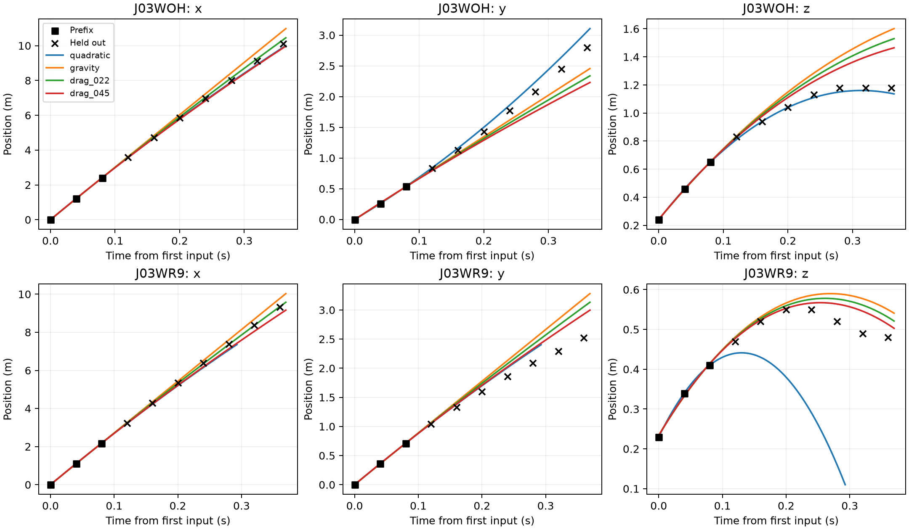

# 两次真实点球的前段拟合与留出外推

固定前三帧（0、0.04、0.08秒）拟合初始状态，仅评分参考过门时刻之前的留出帧。
物理对照固定零旋，Cd=0、0.22、0.45；恒加速度由三点插值得到。所有模型预先指定，逐项报告。

| 案例 | 模型 | 留出评分/应评分 | 三维RMSE m | 共同帧RMSE m | 过门点误差 m |
| --- | --- | --- | ---: | ---: | ---: |
| J03WOH | quadratic | 7/7 | 0.190 | 0.190 | 0.374 |
| J03WOH | gravity | 7/7 | 0.505 | 0.505 | 0.664 |
| J03WOH | drag_022 | 7/7 | 0.349 | 0.349 | 0.647 |
| J03WOH | drag_045 | 7/7 | 0.393 | 0.393 | 0.627 |
| J03WR9 | quadratic | 5/7 | 0.317 | 0.317 | 未到达 |
| J03WR9 | gravity | 7/7 | 0.450 | 0.265 | 0.546 |
| J03WR9 | drag_022 | 7/7 | 0.310 | 0.190 | 0.542 |
| J03WR9 | drag_045 | 7/7 | 0.331 | 0.215 | 0.539 |

共同帧列对每个案例使用所有模型均能预测的相同帧集；数量分别为 J03WOH 7帧、J03WR9 5帧。提前触地造成的缺失仍作为失败报告。



## 解释范围

- 参考轨迹为摄像追踪估计。过门标签由相邻留出帧插值，绝对三维精度和离脚时刻未独立标定。
- 空气密度1.20 kg/m³，质量0.430 kg，半径0.110 m。预测在球心下降到半径高度时停止。
- 两次观测之外的起始位置也有追踪误差，因此用三帧联合拟合六维初始状态。无参数使用留出帧拟合。
- 三点恒加速度恰好插值噪声，误差可能随外推放大。零旋物理模型也可能因缺少升力而失配。
- 本轮是点预测基线评测，尚未评估旋转后验或神经网络，也没有给出实测概率覆盖率。
- 在参考过门后的追踪点单独排除，避免把可能的球网接触纳入自由飞行误差。完整预测保留以便复核。
- 两个进球案例不足以确定总体方法排名。后续若据此调整模型，应报告为开发对照并使用新案例验证。

- 前期数据完整性审计已查看完整轨迹，本轮定位为开发外推对照。代码确保留出帧不进入初值拟合，不能将本轮描述为盲评。

## 复现

```powershell
python student_b/validate_real_penalties.py
```

配置见 protocol.json，冻结前段预测见 prefix_predictions.json，逐点结果见 point_predictions.csv。
