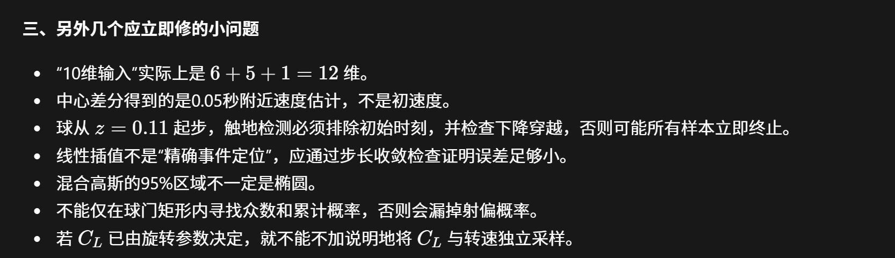

# 微信「溪上」消息归档 · 2026-11-07 18:02（14 条）

| 项 | 内容 |
|---|---|
| 会话 | 微信私聊「溪上」（队友 x1shang） |
| 时间 | 2026-11-07 18:02（微信显示时间；文件落盘 18:02:07–18:02:45） |
| 条数 | **14 条** = 3 条文字 + 1 条链接 + 1 张图片 + 9 个文件 |
| 归档位置 | `wechat_archive/2026-11-07_溪上/` |
| 转录原则 | 文字逐字转录（保留原始 Markdown/LaTeX 写法）；图片按原始字节保存；压缩包原样保存 |

> 说明：这是溪上发来的**连续 14 条**消息，起点为「UPC B 题气动参数与取值依据」长文，终点为 `upc_b_48.md` 文件卡。上一条（更早）是 Tailscale 排障对话，不属于本次归档范围。

---

## 1. 逐条记录

### 01 · 文字｜UPC B 题气动参数与取值依据

**UPC B 题气动参数与取值依据**

- **足球质量与半径。** 取 \(m=0.430\,\mathrm{kg}\)、\(R=0.110\,\mathrm m\)，迎风面积 \(A=\pi R^2=0.0380\,\mathrm{m^2}\)。IFAB 规定比赛用球质量为 \(0.410\)–\(0.450\,\mathrm{kg}\)、周长为 \(0.68\)–\(0.70\,\mathrm m\)，换算半径约 \(0.108\)–\(0.111\,\mathrm m\)。[IFAB《足球竞赛规则》第 2 条](https://www.theifab.com/laws/latest/the-ball/)
- **空气密度与雷诺数。** 采用 Asai 等风洞计算中的 \(\rho_{\mathrm{air}}=1.20\,\mathrm{kg/m^3}\)。取空气运动黏度 \(\nu=1.54\times10^{-5}\,\mathrm{m^2/s}\)，则 \(Re=2RU/\nu\)，其中 \(U\) 是球相对空气的速率。题面球速约 \(31.5\,\mathrm{m/s}\) 时，无风下 \(Re\approx4.5\times10^5\)。[Asai et al. (2007)](https://doi.org/10.1007/BF02844207) · [Goff & Carré (2010)](https://doi.org/10.1088/0143-0807/31/4/007)
- **阻力系数 \(C_D\)。** Asai 等测得无旋球在亚临界区 \(C_D\approx0.43\)，在超临界区 \(C_D\approx0.15\)，临界 \(Re\) 约为 \(2.2\)–\(3.0\times10^5\)。Bray & Kerwin 从有旋任意球轨迹得到 \(C_D=0.25\)–\(0.30\)。本题高速段可先取 **\(C_D=0.22\)**，用 **\(0.15\)–\(0.30\)** 做敏感性分析。若要模拟跨越阻力危机，可用 Goff & Carré 式 (3) 的无旋 Teamgeist 拟合 \(C_D(U)=0.155+0.346/[1+\exp((U-12.19)/1.309)]\)，其中 \(U\) 以 \(\mathrm{m/s}\) 代入。[Asai et al. (2007)](https://doi.org/10.1007/BF02844207) · [Bray & Kerwin (2003)](https://doi.org/10.1080/0264041031000070994) · [Goff & Carré (2010)](https://doi.org/10.1088/0143-0807/31/4/007)
- **马格努斯升力系数 \(C_L\)。** 定义自旋参数 \(S=R\omega_\perp/U\)，其中 \(\omega_\perp\) 是垂直于相对气流方向的自旋分量大小。可先采用 **\(|C_L(S)|=\min(1.4S,\,0.30)\)**。这是本题选用的截断线性近似：斜率参考 Asai 等报告的 \(S\approx0.18\) 时马格努斯系数约 \(0.25\)，上限参考 Bray & Kerwin 的 \(C_L=0.23\)–\(0.29\)。Goff & Carré 图 6–7 显示升力系数随自旋增强而上升，并在较大自旋参数下趋缓。**式中的 \(1.4\) 和 \(0.30\) 是本题的建模取值**，可随球型和流动条件调整。[Asai et al. (2007)](https://doi.org/10.1007/BF02844207) · [Bray & Kerwin (2003)](https://doi.org/10.1080/0264041031000070994) · [Goff & Carré (2010)](https://doi.org/10.1088/0143-0807/31/4/007)

存放：`messages/01_气动参数与取值依据.md`（2,413 B）

---

### 02 · 链接｜仓库邀请

```text
https://github.com/blind-shrimp/UPC155/invitations
```

存放：`messages/02_仓库邀请链接.md`

> 这是 GitHub 仓库协作邀请链接（可能一次性/有有效期）。

---

### 03 · 图片｜对 B 组代码/报告的修订意见

原图 1666×481（JPEG），138,692 B。



图片文字（人工转录，便于检索；以原图为准）：

1. 「10 维输入」实际上是 6 + 5 + 1 = 12 维。
2. 中心差分得到的是 0.05 秒附近速度估计，不是初速度。
3. 球从 z = 0.11 起步，触地检测必须排除初始时刻，并检查下降穿越，否则可能所有样本立即终止。
4. 线性插值不是「精确事件定位」，应通过步长收敛检查证明误差足够小。
5. 混合高斯的 95% 区域不一定是椭圆。
6. 不能仅在球门矩形内寻找众数和累计概率，否则会漏掉射偏概率。
7. 若 C_L 已由旋转参数决定，就不能不加说明地将 C_L 与转速独立采样。

存放：`images/03_消息原图.png`

---

### 04 · 文件｜`physics_simulation.py`（9,705 B）

单轨迹 `solve_ivp` 参考实现：含浮力项、竖直自旋轴升力、CLI；与仓库 `student_b/physics.py`（批量 RK4）**不是同一实现**。

存放：`code/physics_simulation.py`

---

### 05 · 文字｜训练进度与数据请求

B 组已完成 5 万条仿真训练和第一轮模型对照。[验证报告](C:/Users/pc/Documents/ChatGPT/upc/student_b/ISSIA筛选与仿真验证.md)

A 同学：如果已经拿到真实轨迹，请发文件或链接，以及帧率、坐标单位和离脚时刻说明。如果暂时没有，回一句“没有新数据”即可。若手边有 ISSIA 原视频，麻烦核查 608–627 帧、1144–1172 帧，记录球是否中途碰人、触地或被遮挡。这两段先按普通空中飞行处理。

存放：`messages/05_训练进度与数据请求.md`（507 B）

---

### 06 · 文字｜外推检验与论文口径

两段数据已用前 6 帧拟合、后续帧检验。两段加阻力后都比只考虑重力的外推更准，但 \(C_D=0.45\) 没有在两段都改善结果。建议主模型继续用 \(C_D=0.15–0.30\)，扩到 0.45 单列为敏感性分析。题面案例在 5 mm 误差假设下，扩宽后后验均值移动约 2.6 cm。C 可以把 ISSIA 写成两段真实空中轨迹的外推检验，点球覆盖率仍引用仿真结果。另请把恒加速度基线的 \(Z\) 统一为 1.920 m。

存放：`messages/06_外推检验与论文口径.md`（490 B）

---

### 07 · 文件｜`气动参数更新结果.md`（2,312 B）

与仓库 `student_b/气动参数更新结果.md` **逐字一致**（仅换行差异）。

存放：`reports/气动参数更新结果.md`

---

### 08 · 文件｜`UPC_B_给B的ISSIA数据与待确认_2026-11-07.zip`（375,895 B）

第一轮 A→B 数据包；已被 12 的 v2 取代，仅作留档。

存放：`packages/UPC_B_给B的ISSIA数据与待确认_2026-11-07.zip`；解包于 `extracted/A到B_v1/`

---

### 09 · 文件｜`给A的回签与ISSIA外推结果.md`（3,745 B）

与仓库 `student_b/给A的回签与ISSIA外推结果.md` **逐字一致**（仅换行差异）。

存放：`reports/给A的回签与ISSIA外推结果.md`

---

### 10 · 文件｜`params.json`（1,608 B）

与仓库 `student_b/params.json` **字节完全一致**（SHA256 相同）。

存放：`parameters/params.json`

---

### 11 · 文件｜`ISSIA筛选与仿真验证.md`（4,085 B）

与仓库 `student_b/ISSIA筛选与仿真验证.md` **逐字一致**（仅换行差异）。

存放：`reports/ISSIA筛选与仿真验证.md`

---

### 12 · 文件｜`UPC_B_给B的交接包_v2_2026-11-07.zip`（383,458 B）

A→B 第二轮交接包 v2。解包后 21 个文件，其中 18 个与仓库 `handoff/A到B_v2_2026-11-07/` **逐字一致**（仅换行差异）；多出的 3 个大 CSV 只在包内（`ISSIA-3D_raw.csv`、`ISSIA_native_normalized.csv`、`ISSIA_valid_3d_only.csv`），未入库。

存放：`packages/UPC_B_给B的交接包_v2_2026-11-07.zip`；解包于 `extracted/A到B_v2/`

---

### 13 · 文件｜`UPC-B题-团队实验方案.md`（7,762 B）

与仓库根目录 `UPC-B题-团队实验方案.md` **逐字一致**（仅换行差异）。

存放：`plans/UPC-B题-团队实验方案.md`

---

### 14 · 文件｜`upc_b_48.md`（25,303 B）

《UPC B题 48 小时极限冲金实验方案（含人工必做清单与夜间挂机策略）》，196 行方案稿；仓库内此前无此文件（`inventory.md` §G 只有对其的评估摘要，结论是按保守路线执行）。

存放：`plans/upc_b_48.md`

---

## 2. 按类型存放（本目录）

```
2026-11-07_溪上/
├── 00_对话记录.md          # 本文件：14 条消息 + 分类 + 校验
├── messages/               # 文字消息 4 条（01、02、05、06）
├── images/                 # 图片 1 张（03）
├── code/                   # 代码 1 个（04）
├── parameters/             # 参数表 1 个（10）
├── reports/                # 报告 3 份（07、09、11）
├── plans/                  # 方案 2 份（13、14）
├── packages/               # 原始压缩包 2 个（08、12）
└── extracted/              # 两个包的解包结果（A到B_v1 / A到B_v2）
```

## 3. 与仓库现有文件的关系

| 消息 | 与仓库的关系 | 处理 |
|---|---|---|
| 07、09、11、13 | 与 `student_b/` 或根目录同名文件逐字一致（仅 CRLF/LF） | 原样留档，不覆盖仓库文件 |
| 10 `params.json` | 与 `student_b/params.json` 字节一致 | 原样留档 |
| 12 v2 包 | 与 `handoff/A到B_v2_2026-11-07/` 内容一致，另含 3 个大 CSV | 仓库只保留文本与两段轨迹；大表留在此包 |
| 08 v1 包 | 被 v2 取代 | 仅留档 |
| 04 `physics_simulation.py` | 仓库无同文件 | **新增参考实现**（未接入主流程） |
| 14 `upc_b_48.md` | 仓库此前只有 `inventory.md` §G 的评估摘要 | **新增方案稿** |
| 01、02、03、05、06 | 仓库无同文件 | 新增（消息原文/截图） |

> 结论：这批消息里**只有 04 和 14 是仓库此前没有的文件**；其余 7 个附件与仓库已有内容一致，v1/v2 压缩包提供完整原始包与 3 个大 CSV 的留档。

## 4. 校验和（SHA256）

| # | 文件 | 字节 | SHA256 |
|---|---|---:|---|
| 01 | messages/01_气动参数与取值依据.md | 2,413 | `75C56C0E5B80F9EB3ED3D0C0591FA0C8B5C3C42784720BD87F697E7CBCCC890A` |
| 02 | messages/02_仓库邀请链接.md | 51 | `D7197F20EE7683985611D69FC1E06D68E553C6AF2815291DB8A9D675013F507E` |
| 03 | images/03_消息原图.png | 138,692 | `672B51C17559DDA9B9561040D530CCD92F0E79131D1E021A89D023C3A942E5BC` |
| 04 | code/physics_simulation.py | 9,705 | `AE88D351010972FC2101F326BE6E93916EFCEE361712DC9D7F51E6DC854109B9` |
| 05 | messages/05_训练进度与数据请求.md | 507 | `455D8267B24332999C08543E3BB2501063911CD66F572B72F2530EFCEE110250` |
| 06 | messages/06_外推检验与论文口径.md | 490 | `40F396B241630C186FD331B200BC83CE44AD848178C9BEB54A97FD0F2F12F4D8` |
| 07 | reports/气动参数更新结果.md | 2,312 | `553759A3BDE9549BF04878115357897CAB291DCE513A9B86D857FE550846F6BF` |
| 08 | packages/UPC_B_给B的ISSIA数据与待确认_2026-11-07.zip | 375,895 | `FEAFED74DF94997A0AF5D247F2AC0B95158FCEB6FD481E3ABEDD5FA5CAE66C0B` |
| 09 | reports/给A的回签与ISSIA外推结果.md | 3,745 | `692D57A32628BED91634471811169505BAB5EC5AB2896089D66A119DA3FEF201` |
| 10 | parameters/params.json | 1,608 | `9D949A859BFE40180B9626650D9429B49EB8D2548055050B8613FCF926A8FFBA` |
| 11 | reports/ISSIA筛选与仿真验证.md | 4,085 | `156DA3DB53D537855C4CBD8E66D9E956FCD77C1D6F8868D507BAD21993B633DE` |
| 12 | packages/UPC_B_给B的交接包_v2_2026-11-07.zip | 383,458 | `11AA04CA28E1B3B8975B37759E93D3E5D133EE0D8B50B277931D55B43D0F0150` |
| 13 | plans/UPC-B题-团队实验方案.md | 7,762 | `9811618CB33D9E295C47066D566DD86615B86A211F50B0DF11EAAA963265A8A9` |
| 14 | plans/upc_b_48.md | 25,303 | `53F98B4022AECA0C45836CC9FE21FC800934923B1FB39B2192E0A14F82322B47` |

## 5. 备注

- 07、09、11、13 的换行差异来自微信下载（CRLF）与仓库（LF），逐字内容一致；引用请以仓库版本为准。
- 03 的 7 条意见与本仓库 `student_b/审查清单.md` 部分重叠，但表述不同，可作第二轮审查输入。
- 02 的邀请链接若已失效，请让溪上重新发；仓库地址为 <https://github.com/blind-shrimp/UPC155>。
